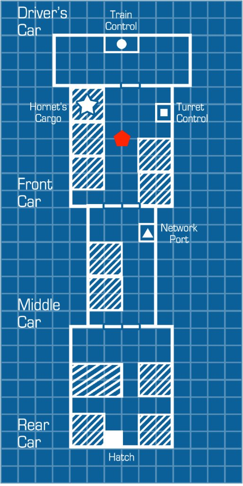

# Ładunek Czerwonego Chromu (Red Chrome Cargo)

**Krzykacz (Screamsheet) do systemu Cyberpunk RED**

* **Scenariusz:** Santiago Betancur
* **Tekst i projekt:** Cody Pondsmith
* **Kierownictwo artystyczne:** Jaye Kovach
* **Zarządzanie:** Lisa Pondsmith
* **Skład:** J Gray
* *Copyright © 2020 by R. Talsorian Games, Inc. Cyberpunk jest zastrzeżonym znakiem towarowym CD Projekt Red S.A.*

---

## Krzykacz: Night City Today News (NCT)

> **09:37** | Sekcja: **LOKALNE** *(inne: Plotki, Opinie, Pogoda, Tech, Styl życia, Biznes, Świat)*

### Wojna gangów wybucha w Strefie Walki
*autor: Jericho Hunt*

Dzisiaj rano północny sektor Strefy Walki pogrążył się w chaosie, gdy napięcia między **Iron Sights** a **Red Chrome Legion** przerodziły się w pełnoskalowy konflikt. Kule świszczały, a rippery cięły powietrze, gdy te dwa brutalne gangi dały upust miesiącom narastającej wrogości wobec siebie oraz każdego pechowego mieszkańca Night City, który znalazł się na drodze ich krwawej waśni. Funkcjonariusze NCPD są już na miejscu i próbują stłumić tę bezsensowną przemoc, jednak doniesienia o udziale wielu osób po pełnej konwersji ciała wymusiły wezwanie **C-SWAT**. Bez wątpienia konflikt ten wkrótce rozleje się poza granice Strefy Walki, jeśli sytuacja będzie dalej eskalować.

Co jednak wywołało tę rzeź? Czy za tym starciem kryje się coś więcej niż tylko niejasno wytyczone granice terytoriów i ostre słowa? Czy może to być sprawka jakiegoś cienistego, zakulisowego gracza z zewnątrz? *Night City Today* przedstawia całą historię w pełnych dramatyzmu szczegółach.

Łatwo założyć, że konflikt ten wynika z drobnych potyczek terytorialnych, które Red Chrome Legion i Iron Sights toczą od kilku lat, odkąd członkowie Legionu zaczęli rekrutować młodszych rekrutów na terenach tradycyjnie kontrolowanych przez Iron Sights. Po upadku Arasaki w IV Wojnie Korporacyjnej wspierany przez korporację gang Iron Sights stracił znaczną część swoich wpływów. W rezultacie Legion — podobnie jak inne gangi — obrał Iron Sights za cel. Red Chrome Legion słynie z miażdżenia rywali, anektowania ich terytoriów i indoktrynowania młodszych członków w szeregi swojej neofaszystowskiej grupy, jednak ostatnie starcia wskazują, że Iron Sights nie ograniczają się już do obrony własnego terenu i w rzeczywistości to oni występują w tej wojnie jako agresor. Reporterzy *Night City Today* dotarli do tropu, który wskazuje na niepokojący powód tej zmiany taktyki.

Jak wie każdy w północnym Night City, niegdyś potężni Iron Sights zaliczyli w ostatnich latach cudowny powrót. Odcięci od finansowania Arasaki członkowie Iron Sights — w niemal całości składający się z osób po pełnych konwersjach ciała oraz ciężko zmodyfikowanych jednostek na skraju lub w samym środku cyberpsychozy — w Czasie Czerwieni utracili wpływy i terytoria. Dopiero niedawno szeregi gangu znów zaczęły rosnąć. Początkowo przypisywano to osobom cierpiącym na cyberpsychozę, które dołączały do nich po nieudanych próbach powrotu do społeczeństwa. Niedawno jednak nieustraszony reporter Jericho Hunt dokonał odkrycia, które wstrząśnie miastem i bez wątpienia rzuca światło na obecną masakrę. Działając pod przykrywką na stacji kolejowej obsługiwanej przez Nomadów na obrzeżach Night City, Hunt był świadkiem przekazania towaru między znanymi współpracownikami Iron Sights a tajemniczą kliką mężczyzn w czarnych garniturach. W wyniku transakcji Iron Sights weszli w posiadanie kilku skrzyń sprzętu wojskowego, który — jak zauważył Hunt — był nowy i bezsprzecznie pochodził z Nocnego Targu (*Midnight Market*). Wygląda na to, że Iron Sights rzeczywiście zyskali nowego dobroczyńcę.

Zaledwie kilka dni po tym przekazaniu NCPD zgłosiło atak Red Chrome Legion na nieoznakowaną ciężarówkę wjeżdżającą do miasta. Ciężarówka bez wątpienia przewoziła kolejną dostawę od tajemniczej kliki. Hunt uważa, że najnowszy zwrot w wojnie gangów to zemsta ze strony Iron Sights, którzy zamierzają zniszczyć Red Chrome Legion i odzyskać to, co zostało im skradzione.

**Powiązane linki:**
* *Iron Sights dostają nową broń*
* *Rozkład sił gangów w Night City*
* *Trzeci napad na ciężarówkę w tym tygodniu*

> **Reklama:** `GRAF 3 — PRZEWIEZIE WSZYSTKO. — ZHIRAFA`

---

## Informacje dla Graczy

Znany Fixer o pseudonimie **Hornet** *(CPRED str. 305)* kontaktuje się z drużyną za pośrednictwem ich lokalnego Fixera i oferuje im lukratywne, lecz niebezpieczne zlecenie. Hornet proponuje po **2 000 eb** na głowę za odzyskanie ładunku skradzionego przez **Red Chrome Legion** *(CPRED str. 309)*.

Przesyłka składa się z **czterech dużych skrzyń** zabezpieczonych zamkami kodowanymi DNA. Hornet nie zdradził drużynie, co znajduje się w kontenerach — powiedział jedynie, że podczas transportu muszą obchodzić się z nimi bardzo ostrożnie.

Ładunek jest właśnie przewożony do placówki Red Chrome Legion poza miastem na pokładzie **Hammerheada** — ciężko opancerzonego pociągu towarowego Militechu, który gang porwał. Brak szczegółowych informacji o tym, co czeka na BG wewnątrz pociągu, ale 2 000 eb na osobę to całkiem niezła stawka. Przecież nie może być aż tak źle...

---

## Notatki dla Mistrza Gry (MG)

Trzy z kontenerów, które BG mają odzyskać, są wypełnione wojskowymi materiałami wybuchowymi oraz wszczepami pierwotnie przeznaczonymi dla **Iron Sights** *(CPRED str. 308)*. Ostatni kontener zawiera kilka kanistrów ze śmiertelną neurotoksyną opracowaną przez samego Horneta.

Neurotoksyna ta została kupiona za ciężkie pieniądze jako as w rękawie dla Iron Sights do użycia przeciwko Red Chrome Legion oraz każdemu innemu gangowi, który sprawiałby poważne problemy. Red Chrome Legion ukradł kontenery, ale zamki kodowane DNA oraz grube metalowe ścianki okazały się zbyt trudne do sforsowania bez uszkodzenia zawartości.

Obecnie transport zmierza do opuszczonego miasteczka na północnych obrzeżach Night City, gdzie zatrudniony przez Red Chrome Legion Technik będzie w stanie złamać zamki.

### Wejście na pokład pociągu

Hornet organizuje dla BG przejazd własnym pociągiem, który pojedzie równolegle do lokomotywy Red Chrome Legion. Gdy oba składy zbliżą się do siebie, BG muszą przeskoczyć z dachu pociągu Horneta na dach pociągu Legionu, wykonując **test Atletyki o PT 13** (*DV13 Athletics Check*). Niezdanie tego testu oznacza, że postać nie doskakuje i uderza w bok tylnego wagonu. Udaje jej się jednak złapać i nie spaść na ziemię, lecz hałas kolizji alarmuje strażników wewnątrz pociągu o zagrożeniu.

Po wejściu na dach pociągu BG muszą otworzyć właz techniczny na szczycie tylnego wagonu za pomocą **testu Podstawowych Technik o PT 13** (*DV13 Basic Tech Check*). Zapewnia to dostęp do wnętrza pociągu.

### Tylny wagon (Rear Car)

W tylnym wagonie znajduje się **dwóch strażników Red Chrome Legion** *(użyj statystyk Boostergangera: CPRED str. 412; dodaj Strzelbę / Shotgun; zwiększ liczbę strażników o 1, jeśli w drużynie jest 5 lub więcej BG)*.

Kontenery w wagonie są wystarczająco wysokie, aby zasłonić właz techniczny, co pozwala BG spróbować cichego wejścia i zaskoczenia strażników.

### Środkowy wagon (Middle Car)

Jeśli BG dotrą do środkowego wagonu, przekonają się, że jest on pusty poza kilkoma kontenerami i portem sieciowym/serwisowym (*maintenance port*). Do portu tego może podłączyć się Netrunner (zob. **Mainframe pociągu Hammerhead** poniżej).

Dostęp do **Manifestu Ładunku Hammerheada** daje BG listę każdego przedmiotu znajdującego się na pokładzie w momencie porwania pociągu przez Red Chrome Legion. Sprytny MG może wykorzystać tę listę, aby podsunąć BG nowy sprzęt lub kilka zahaczek fabularnych. Jeśli Netrunner przejmie **Węzeł Kontrolny Wieżyczki** (*Turret Control Node*), nie tylko dowie się o wieżyczce w następnym wagonie, ale będzie mógł przejąć nad nią kontrolę.

### Przedni wagon (Front Car) i ucieczka

W przednim wagonie BG napotykają grupę strażników Red Chrome Legion *(użyj statystyk Boostergangera: CPRED str. 412; dodaj Strzelbę / Shotgun)* w liczbie równej **liczbie BG minus 1**, oraz jednego **Oficera Red Chrome Legion** *(użyj statystyk Agenta Ochrony / Security Operative: CPRED str. 413)*.

Jeśli strażnicy zostali wcześniej zaalarmowani o wejściu BG na pokład pociągu, **automatyczna wieżyczka** *(użyj Automated Turret: CPRED str. 214)* na środku pomieszczenia jest już aktywna. Jeśli wieżyczka nie została jeszcze aktywowana, jeden ze strażników Legionu w swojej pierwszej turze podbiegnie do panelu sterowania wieżyczką i ją uruchomi.

Poszukiwane przez BG kontenery znajdują się w przednim wagonie. Każdą skrzynię może nieść pojedynczy BG, ale wymaga to użycia obu rąk. BG mogą:
1. Zatrzymać normalnie zautomatyzowanego Hammerheada, korzystając z konsoli w **wagonie maszynisty** (*Driver's Car*) przy pomocy **testu Prowadzenia Pojazdów Lądowych o PT 9** (*DV9 Drive Land Vehicle Check*), **ALBO**
2. Wspiąć się z powrotem drogą, którą weszli, i przeskoczyć na pociąg Horneta.

* **Skok z niesioną skrzynią:** **test Atletyki o PT 15** (*DV15 Athletics Check*).
* **Przerzucenie kontenera na drugi pociąg:** **test Atletyki o PT 13** (*DV13 Athletics Check*).

Po powrocie na pociąg Horneta BG mogą przekazać mu kontenery i odebrać zapłatę. Do końca tygodnia wojna gangów w północnej części Strefy Walki kończy się, gdy Iron Sights wykorzystują nowy transport sprzętu i trucizny, by zmiażdżyć Red Chrome Legion.

---

## Mainframe Hammerheada

| Piętro | Po drugiej stronie „Drzwi” | PT (DV) |
| :---: | :--- | :---: |
| **1** | Hasło (*Password*) | 6 |
| **2** | Plik zawierający oryginalny manifest ładunku Hammerheada | 8 |
| **3** | Hasło (*Password*) | 8 |
| **4** | Hellhound *(Black ICE)* | Nd. |
| **5** | Węzeł Kontrolny (*Control Node*) sterujący Automatyczną Wieżyczką | 8 |

---

## Mapa: Pociąg Towarowy Hammerhead

**Legenda mapy:**
* **● Sterowanie pociągiem** (*Train Control*) — konsola w wagonie maszynisty (PT 9 Prowadzenie Pojazdów Lądowych, aby zatrzymać pociąg).
* **★ Ładunek Horneta** (*Hornet's Cargo*) — 4 skrzynie z zamkami DNA (na mapie oznaczona strefa z gwiazdką w przednim wagonie).
* **■ Panel Wieżyczki** (*Turret Control*) — sterowanie wieżyczką w przednim wagonie.
* **◆ Automatyczna Wieżyczka** (*czerwony pięciokąt*) — na środku przedniego wagonu.
* **▲ Port Sieciowy** (*Network Port*) — gniazdo dostępowe do Mainframe'u Hammerheada w środkowym wagonie.
* **[WŁAZ]** (*Hatch*) — właz techniczny na dachu tylnego wagonu (PT 13 Podstawowe Techniki).
